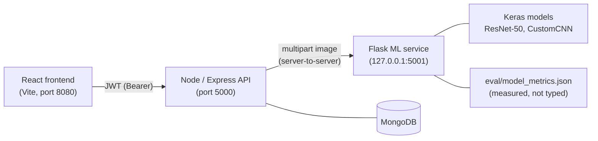

# DataScoop: Alzheimer MRI decision-support prototype

DataScoop is a full-stack research prototype. A doctor or patient uploads one **2D brain MRI slice**. CNN models classify it into 4 classes (*Non*, *Very Mild*, *Mild*, *Moderate Demented*). The result is stored in a doctor/patient platform with appointments, messaging and reports.

> ⚠️ **Research prototype, not a medical device.** The models were trained and evaluated on public 2D Kaggle slices without patient identifiers. Never use them for clinical decisions.

This README separates three things clearly: what is **measured**, what is **implemented**, and what is **not done yet**. Every number below comes from an evaluation run that anyone can reproduce (see [Evaluation](#evaluation)).

---

## What the project is

DataScoop is a team **PFA** (end-of-year project) at ESPRIM, Monastir, Tunisia.

| Part | Who |
|---|---|
| Backend (Node/Express/MongoDB), ML service (Flask), integration | **Abd Elmouhib Souri** |
| Training of the ResNet-50 (Kaggle notebook available) and of the custom CNN and one EfficientNet (notebooks lost) | **Abd Elmouhib Souri** |
| Patient / doctor dashboard UI | **Abd Elmouhib Souri** and **Achref** |
| Frontend scaffold | generated with [Lovable](https://lovable.dev) (React, TypeScript, Vite, Tailwind, shadcn/ui), then extended by the team |
| Data audit, evaluation, removal of simulated outputs, security hardening (Oct–Nov 2026) | **Abd Elmouhib Souri** |

The remaining EfficientNet models were trained within the team. Their training code is not available.

## Architecture



- **ML service** (`ml_service/app.py`): it loads **only** the models marked `enabled` in `eval/model_metrics.json`.
  - A missing or crashing model is **excluded and reported**.
  - If no model can answer, the API returns **HTTP 503**. It never produces a simulated diagnosis.
  - The verdict comes from a model **chosen in advance**: the best measured macro-F1. It is not chosen per image by softmax confidence, because softmax confidence is not calibrated.
- **Backend** (`backend/`): JWT authentication, bcrypt password hashes, and role and ownership checks.
  - If the ML service fails, the backend answers 503 and **writes nothing** to the patient record.
- **Frontend** (`neuro-detect-lab-main/`): doctor and patient dashboards, PWA, Capacitor Android build.

---

## Evaluation

### Data audit: why the original 89–90% is not a valid performance number

The models were trained on a 50,400-image Kaggle folder (4 classes, **no test split, no patient IDs**) with a random 80/20 `validation_split`. An audit of that data found **three levels of leakage** (code: `ml_service/eval/kaggle_evaluation.py`):

1. **Exact duplicates.** There are 195 MD5 groups, and **110 of them are in both train and validation**.
2. **Augmented copies.** Files `aug_<n>_<uuid>.jpg` in training are copies of `<uuid>.jpg` in validation. 57–71% of validation images have a training image with Pearson r > 0.98 (64×64, flip-aware). Between images of **different classes**, which means different patients, **0.0%** reach r > 0.98. That baseline is how the threshold was chosen.
3. **Merged re-uploads.** The same well-known 6,400-image set appears in at least 3 formats (128×128 grayscale, 176×208 grayscale, 180×180 RGB). One format (200×190 grayscale) is almost only *Moderate*, so the image **format** alone can predict the class. That is a shortcut-learning risk.

A **leak-free subset** of the exact original validation split was built: 3,153 / 10,079 images with no source copy, no MD5 duplicate and no near-duplicate (r > 0.98) in training. Its median closest-train correlation is 0.925, the same as the different-patient baseline.

### Results (measured, Kaggle run v1, TensorFlow 2.20, 2× T4, 2026-10-28)

| Model (file) | Real architecture | Training split | Accuracy, original split (leaky, n=10,079) | **Accuracy, leak-free subset (n=3,153) [95% bootstrap CI]** | Macro-F1, leak-free | ECE, leak-free | Status |
|---|---|---|---|---|---|---|---|
| **ResNet50** (`ultra_best_model.h5`) | ResNet-50 (ImageNet) + dense head, fine-tuned | known | 0.900 | **0.814 [0.800–0.826]** | **0.832** | 0.027 | served (primary) |
| **CustomCNN** (`alzheimer_cnn_model.h5`) | 4-block CNN, 11.2 M params | **unknown** (notebook lost) | 0.810 | 0.784 [0.770–0.799] | 0.809 | 0.047 | served (comparison) |
| EfficientNetB0 | EfficientNet-B0 | unknown | 0.317 | 0.297 (predicts one class) | 0.115 | — | **disabled: broken** |
| EfficientNetB3 / B4 | EfficientNet-B3 / B4 | unknown | — | — | — | — | disabled: evaluation pending |

How to read this table:
- The pipeline is validated: on the original split, the ResNet-50 reproduces its training-notebook value (0.900 vs 0.8997). **Leakage inflated accuracy by about 8.6 points.**
- **0.814 is still an upper bound**, not a clinical estimate. The split is not patient-level, a 64×64 correlation cannot catch strong augmentations or other slices of the same patient, and the clean subset comes mostly from one image source.
- The CustomCNN's training split is unknown, so its numbers may include images it was trained on.
- `best_model.h5`, presented in the old version as "ResNet-50, 89.25%", is **the same network as the CustomCNN**: identical predictions on all 10,079 images, plus the saved optimizer state. The 89.25% figure appears in no training log. It was removed.
- EfficientNet-B0 fails with both preprocessings (/255 and raw 0–255), so it is disabled. Its low ECE shows that **good calibration does not imply a useful model**.

To reproduce: run the Kaggle evaluation notebook (dataset audit, then leak-free subset, then model evaluation), then `python ml_service/eval/summarize_results.py results.json`. This rewrites `model_metrics.json` and the results table. **No accuracy in the code is typed by hand.**

---

## Security (what is implemented, with tests)

| Risk in the original code | Now | Proof |
|---|---|---|
| Patient records and MRIs readable and writable **without login** | JWT required; a patient sees only **his own** record; writes are doctor-only with a field whitelist | `backend/tests/security.test.js`, plus live HTTP: 401 without token |
| Token = Mongo `_id` or **email** | Signed **JWT** (HS256 pinned, 8 h expiry, secret ≥ 32 chars or the server refuses to start) | forged, `alg=none` and expired tokens → 401 |
| Plain-text passwords; login query built from the raw body | **bcrypt** (12 rounds) + migration script; lookup by email, then hash compare | `{"password":{"$ne":null}}` → **400** |
| Public default doctor key (`NEURO2026`) | No default: doctor sign-up is disabled unless `DOCTOR_SECRET_KEY` is set; constant-time compare | test: old key → 403 |
| Records linked by **name** (unanchored regex: "Ali" matched "Alia…") | Linked by account id or exact email only; name-based "auto-repair" removed | test: patient A cannot read patient B → 403 |
| CORS open to every origin | Allowed origins from `FRONTEND_ORIGIN` | — |
| Fake outputs: random diagnoses saved to records, random dashboard chart, invented "heatmap", drug doses and MRI findings generated from the class label, hard-coded "95.2% accuracy" | **All removed** | ML: `ml_service/tests`; backend: ML down → 503 and nothing written |

**Tests:** 12 Python tests (`cd ml_service && python -m pytest -q`) and 15 backend tests (`cd backend && npm test`). Both suites run without TensorFlow or MongoDB. For the key guarantees, a mutation check was done: putting the old bug back makes the tests fail.

---

## Run it locally

Requirements: Node ≥ 18, Python 3.10+, MongoDB, and [Git LFS](https://git-lfs.com) (the models are ~435 MB).

```bash
git clone https://github.com/Abd-Elmouhib-Souri/DataScoop.git
cd DataScoop && git lfs pull                     # downloads the .h5 models (otherwise they are 130-byte pointers)

# 1) ML service
cd ml_service && python -m venv .venv && . .venv/bin/activate   # Windows: .\.venv\Scripts\Activate.ps1
pip install -r requirements.txt && python app.py                # -> "Loaded: ['CustomCNN', 'ResNet50']"

# 2) Backend (new terminal)
cd backend && cp .env.example .env   # fill MONGO_URI and JWT_SECRET (see comments in the file)
npm install && node seed.js && npm start

# 3) Frontend (new terminal)
cd neuro-detect-lab-main && npm install && npm run dev          # http://localhost:8080
```

Seeded **local demo accounts**: `doctor@demo.com` and `user@demo.com`, password `password` (stored as bcrypt hashes). Change them before exposing the app anywhere. If you already have a database with plain-text passwords, run `node scripts/migrate-passwords.js` once. On Windows, `run_all.bat` starts the three services.

---

## Limitations and known issues

- **Data.** 2D slices from merged Kaggle uploads with no patient IDs. No patient-level split is possible on this data, so all numbers are optimistic upper bounds.
- **Model choice.** The 4 classes come from the source dataset labels (CDR-based in OASIS-derived sets). The models do not localise or measure anything, and no explainability (Grad-CAM) is implemented yet.
- **Calibration.** Confidence values are raw softmax outputs (ECE is reported above, but no calibration is applied).
- **Access control.** Any doctor can see all patients (needed by the Reports page); there is no per-doctor isolation yet. Emails are not verified at sign-up.
- **Chatbot.** The "assistant" is a rule-based FAQ (keyword and word-overlap matching on a trilingual JSON). It is not an LLM. `ml_service/chatbot_service.py` is an unused earlier version.
- **Code debt.** 3 TypeScript type errors pre-date this work (the build still succeeds). 2 moderate `npm audit` findings remain in a dev-only dependency (`nodemon`/`minimatch`). Some leftover project names (NeuroDetect / MindCare) remain in the UI and Android config.

## Next steps

1. Retrain the ResNet-50 on a dataset **with subject IDs** (e.g. OASIS-1) using a **patient-level split**, with augmentation applied only at training time.
2. Grad-CAM on held-out examples.
3. Temperature scaling, and a reliability diagram for the confidence values.
4. Docker Compose, CI running both test suites, and models hosted on the Hugging Face Hub instead of Git LFS.
